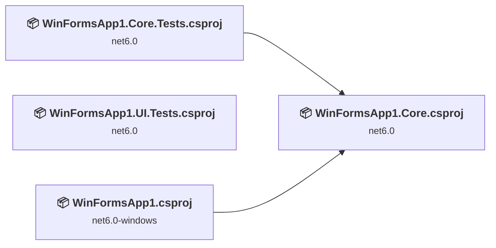
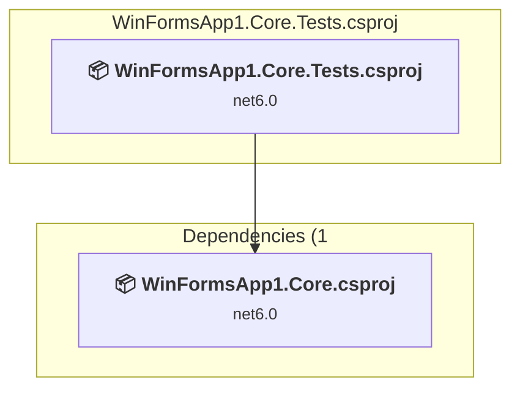
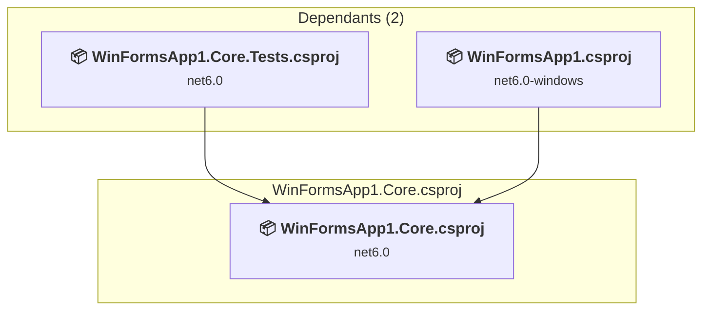
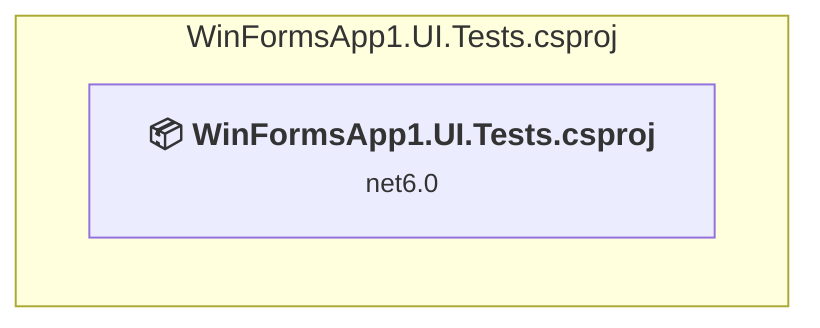
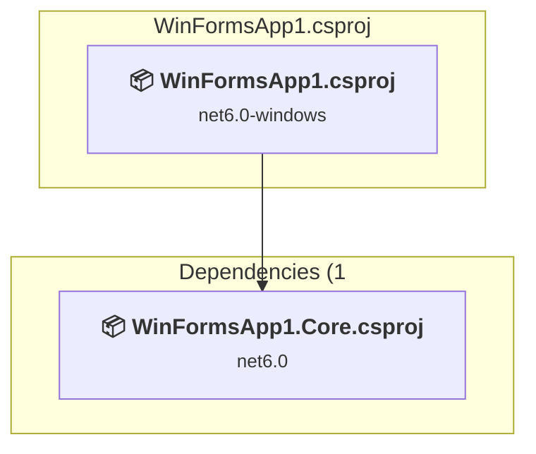

# Projects and dependencies analysis

This document provides a comprehensive overview of the projects and their dependencies in the context of upgrading to .NETCoreApp,Version=v10.0.

## Table of Contents

- [Executive Summary](#executive-Summary)
  - [Highlevel Metrics](#highlevel-metrics)
  - [Projects Compatibility](#projects-compatibility)
  - [Package Compatibility](#package-compatibility)
  - [API Compatibility](#api-compatibility)
  - [Binding Redirect Configuration](#binding-redirect-configuration)
- [Aggregate NuGet packages details](#aggregate-nuget-packages-details)
- [Top API Migration Challenges](#top-api-migration-challenges)
  - [Technologies and Features](#technologies-and-features)
  - [Most Frequent API Issues](#most-frequent-api-issues)
- [Projects Relationship Graph](#projects-relationship-graph)
- [Project Details](#project-details)

  - [WinFormsApp1.Core.Tests\WinFormsApp1.Core.Tests.csproj](#winformsapp1coretestswinformsapp1coretestscsproj)
  - [WinFormsApp1.Core\WinFormsApp1.Core.csproj](#winformsapp1corewinformsapp1corecsproj)
  - [WinFormsApp1.UI.Tests\WinFormsApp1.UI.Tests.csproj](#winformsapp1uitestswinformsapp1uitestscsproj)
  - [WinFormsApp1\WinFormsApp1.csproj](#winformsapp1winformsapp1csproj)

## Executive Summary

### Highlevel Metrics

| Metric | Count | Status |
| :--- | :---: | :--- |
| Total Projects | 4 | All require upgrade |
| Total NuGet Packages | 97 | 3 need upgrade |
| Total Code Files | 9 |  |
| Total Code Files with Incidents | 9 |  |
| Total Lines of Code | 420 |  |
| Total Number of Issues | 236 |  |
| Estimated LOC to modify | 228+ | at least 54.3% of codebase |

### Projects Compatibility

| Project | Target Framework | Difficulty | Package Issues | API Issues | Binding Issues | Est. LOC Impact | Description |
| :--- | :---: | :---: | :---: | :---: | :---: | :---: | :--- |
| [WinFormsApp1.Core.Tests\WinFormsApp1.Core.Tests.csproj](#winformsapp1coretestswinformsapp1coretestscsproj) | net6.0 | 🟢 Low | 1 | 0 | 0 |  | DotNetCoreApp, Sdk Style = True |
| [WinFormsApp1.Core\WinFormsApp1.Core.csproj](#winformsapp1corewinformsapp1corecsproj) | net6.0 | 🟢 Low | 0 | 0 | 0 |  | ClassLibrary, Sdk Style = True |
| [WinFormsApp1.UI.Tests\WinFormsApp1.UI.Tests.csproj](#winformsapp1uitestswinformsapp1uitestscsproj) | net6.0 | 🟢 Low | 3 | 1 | 0 | 1+ | DotNetCoreApp, Sdk Style = True |
| [WinFormsApp1\WinFormsApp1.csproj](#winformsapp1winformsapp1csproj) | net6.0-windows | 🟡 Medium | 0 | 227 | 0 | 227+ | WinForms, Sdk Style = True |

### Package Compatibility

| Status | Count | Percentage |
| :--- | :---: | :---: |
| ✅ Compatible | 94 | 96.9% |
| ⚠️ Incompatible | 3 | 3.1% |
| 🔄 Upgrade Recommended | 0 | 0.0% |
| ***Total NuGet Packages*** | ***97*** | ***100%*** |

### API Compatibility

| Category | Count | Impact |
| :--- | :---: | :--- |
| 🔴 Binary Incompatible | 227 | High - Require code changes |
| 🟡 Source Incompatible | 1 | Medium - Needs re-compilation and potential conflicting API error fixing |
| 🔵 Behavioral change | 0 | Low - Behavioral changes that may require testing at runtime |
| ✅ Compatible | 424 |  |
| ***Total APIs Analyzed*** | ***652*** |  |

## Aggregate NuGet packages details

| Package | Current Version | Suggested Version | Projects | Description |
| :--- | :---: | :---: | :--- | :--- |
| coverlet.collector | 3.1.2 |  | [WinFormsApp1.Core.Tests.csproj](#winformsapp1coretestswinformsapp1coretestscsproj) [WinFormsApp1.UI.Tests.csproj](#winformsapp1uitestswinformsapp1uitestscsproj) | ✅Compatible |
| FlaUI.Core | 5.0.0 | 4.0.0 | [WinFormsApp1.UI.Tests.csproj](#winformsapp1uitestswinformsapp1uitestscsproj) | ⚠️El paquete NuGet no es compatible |
| FlaUI.UIA3 | 5.0.0 | 4.0.0 | [WinFormsApp1.UI.Tests.csproj](#winformsapp1uitestswinformsapp1uitestscsproj) | ⚠️El paquete NuGet no es compatible |
| Interop.UIAutomationClient | 10.19041.0 |  | [WinFormsApp1.UI.Tests.csproj](#winformsapp1uitestswinformsapp1uitestscsproj) | ✅Compatible |
| Microsoft.CodeCoverage | 17.1.0 |  | [WinFormsApp1.Core.Tests.csproj](#winformsapp1coretestswinformsapp1coretestscsproj) [WinFormsApp1.UI.Tests.csproj](#winformsapp1uitestswinformsapp1uitestscsproj) | ✅Compatible |
| Microsoft.CSharp | 4.0.1 |  | [WinFormsApp1.Core.Tests.csproj](#winformsapp1coretestswinformsapp1coretestscsproj) [WinFormsApp1.UI.Tests.csproj](#winformsapp1uitestswinformsapp1uitestscsproj) | ✅Compatible |
| Microsoft.NET.Test.Sdk | 17.1.0 |  | [WinFormsApp1.Core.Tests.csproj](#winformsapp1coretestswinformsapp1coretestscsproj) [WinFormsApp1.UI.Tests.csproj](#winformsapp1uitestswinformsapp1uitestscsproj) | ✅Compatible |
| Microsoft.NETCore.Platforms | 1.1.0 |  | [WinFormsApp1.Core.Tests.csproj](#winformsapp1coretestswinformsapp1coretestscsproj) [WinFormsApp1.UI.Tests.csproj](#winformsapp1uitestswinformsapp1uitestscsproj) | ✅Compatible |
| Microsoft.NETCore.Targets | 1.1.0 |  | [WinFormsApp1.Core.Tests.csproj](#winformsapp1coretestswinformsapp1coretestscsproj) [WinFormsApp1.UI.Tests.csproj](#winformsapp1uitestswinformsapp1uitestscsproj) | ✅Compatible |
| Microsoft.TestPlatform.ObjectModel | 17.1.0 |  | [WinFormsApp1.Core.Tests.csproj](#winformsapp1coretestswinformsapp1coretestscsproj) [WinFormsApp1.UI.Tests.csproj](#winformsapp1uitestswinformsapp1uitestscsproj) | ✅Compatible |
| Microsoft.TestPlatform.TestHost | 17.1.0 |  | [WinFormsApp1.Core.Tests.csproj](#winformsapp1coretestswinformsapp1coretestscsproj) [WinFormsApp1.UI.Tests.csproj](#winformsapp1uitestswinformsapp1uitestscsproj) | ✅Compatible |
| Microsoft.Win32.Primitives | 4.3.0 |  | [WinFormsApp1.Core.Tests.csproj](#winformsapp1coretestswinformsapp1coretestscsproj) [WinFormsApp1.UI.Tests.csproj](#winformsapp1uitestswinformsapp1uitestscsproj) | ✅Compatible |
| NETStandard.Library | 1.6.1 |  | [WinFormsApp1.Core.Tests.csproj](#winformsapp1coretestswinformsapp1coretestscsproj) [WinFormsApp1.UI.Tests.csproj](#winformsapp1uitestswinformsapp1uitestscsproj) | ✅Compatible |
| Newtonsoft.Json | 9.0.1 |  | [WinFormsApp1.Core.Tests.csproj](#winformsapp1coretestswinformsapp1coretestscsproj) [WinFormsApp1.UI.Tests.csproj](#winformsapp1uitestswinformsapp1uitestscsproj) | ✅Compatible |
| NuGet.Frameworks | 5.11.0 |  | [WinFormsApp1.Core.Tests.csproj](#winformsapp1coretestswinformsapp1coretestscsproj) [WinFormsApp1.UI.Tests.csproj](#winformsapp1uitestswinformsapp1uitestscsproj) | ✅Compatible |
| runtime.debian.8-x64.runtime.native.System.Security.Cryptography.OpenSsl | 4.3.0 |  | [WinFormsApp1.Core.Tests.csproj](#winformsapp1coretestswinformsapp1coretestscsproj) [WinFormsApp1.UI.Tests.csproj](#winformsapp1uitestswinformsapp1uitestscsproj) | ✅Compatible |
| runtime.fedora.23-x64.runtime.native.System.Security.Cryptography.OpenSsl | 4.3.0 |  | [WinFormsApp1.Core.Tests.csproj](#winformsapp1coretestswinformsapp1coretestscsproj) [WinFormsApp1.UI.Tests.csproj](#winformsapp1uitestswinformsapp1uitestscsproj) | ✅Compatible |
| runtime.fedora.24-x64.runtime.native.System.Security.Cryptography.OpenSsl | 4.3.0 |  | [WinFormsApp1.Core.Tests.csproj](#winformsapp1coretestswinformsapp1coretestscsproj) [WinFormsApp1.UI.Tests.csproj](#winformsapp1uitestswinformsapp1uitestscsproj) | ✅Compatible |
| runtime.native.System | 4.3.0 |  | [WinFormsApp1.Core.Tests.csproj](#winformsapp1coretestswinformsapp1coretestscsproj) [WinFormsApp1.UI.Tests.csproj](#winformsapp1uitestswinformsapp1uitestscsproj) | ✅Compatible |
| runtime.native.System.IO.Compression | 4.3.0 |  | [WinFormsApp1.Core.Tests.csproj](#winformsapp1coretestswinformsapp1coretestscsproj) [WinFormsApp1.UI.Tests.csproj](#winformsapp1uitestswinformsapp1uitestscsproj) | ✅Compatible |
| runtime.native.System.Net.Http | 4.3.0 |  | [WinFormsApp1.Core.Tests.csproj](#winformsapp1coretestswinformsapp1coretestscsproj) [WinFormsApp1.UI.Tests.csproj](#winformsapp1uitestswinformsapp1uitestscsproj) | ✅Compatible |
| runtime.native.System.Security.Cryptography.Apple | 4.3.0 |  | [WinFormsApp1.Core.Tests.csproj](#winformsapp1coretestswinformsapp1coretestscsproj) [WinFormsApp1.UI.Tests.csproj](#winformsapp1uitestswinformsapp1uitestscsproj) | ✅Compatible |
| runtime.native.System.Security.Cryptography.OpenSsl | 4.3.0 |  | [WinFormsApp1.Core.Tests.csproj](#winformsapp1coretestswinformsapp1coretestscsproj) [WinFormsApp1.UI.Tests.csproj](#winformsapp1uitestswinformsapp1uitestscsproj) | ✅Compatible |
| runtime.opensuse.13.2-x64.runtime.native.System.Security.Cryptography.OpenSsl | 4.3.0 |  | [WinFormsApp1.Core.Tests.csproj](#winformsapp1coretestswinformsapp1coretestscsproj) [WinFormsApp1.UI.Tests.csproj](#winformsapp1uitestswinformsapp1uitestscsproj) | ✅Compatible |
| runtime.opensuse.42.1-x64.runtime.native.System.Security.Cryptography.OpenSsl | 4.3.0 |  | [WinFormsApp1.Core.Tests.csproj](#winformsapp1coretestswinformsapp1coretestscsproj) [WinFormsApp1.UI.Tests.csproj](#winformsapp1uitestswinformsapp1uitestscsproj) | ✅Compatible |
| runtime.osx.10.10-x64.runtime.native.System.Security.Cryptography.Apple | 4.3.0 |  | [WinFormsApp1.Core.Tests.csproj](#winformsapp1coretestswinformsapp1coretestscsproj) [WinFormsApp1.UI.Tests.csproj](#winformsapp1uitestswinformsapp1uitestscsproj) | ✅Compatible |
| runtime.osx.10.10-x64.runtime.native.System.Security.Cryptography.OpenSsl | 4.3.0 |  | [WinFormsApp1.Core.Tests.csproj](#winformsapp1coretestswinformsapp1coretestscsproj) [WinFormsApp1.UI.Tests.csproj](#winformsapp1uitestswinformsapp1uitestscsproj) | ✅Compatible |
| runtime.rhel.7-x64.runtime.native.System.Security.Cryptography.OpenSsl | 4.3.0 |  | [WinFormsApp1.Core.Tests.csproj](#winformsapp1coretestswinformsapp1coretestscsproj) [WinFormsApp1.UI.Tests.csproj](#winformsapp1uitestswinformsapp1uitestscsproj) | ✅Compatible |
| runtime.ubuntu.14.04-x64.runtime.native.System.Security.Cryptography.OpenSsl | 4.3.0 |  | [WinFormsApp1.Core.Tests.csproj](#winformsapp1coretestswinformsapp1coretestscsproj) [WinFormsApp1.UI.Tests.csproj](#winformsapp1uitestswinformsapp1uitestscsproj) | ✅Compatible |
| runtime.ubuntu.16.04-x64.runtime.native.System.Security.Cryptography.OpenSsl | 4.3.0 |  | [WinFormsApp1.Core.Tests.csproj](#winformsapp1coretestswinformsapp1coretestscsproj) [WinFormsApp1.UI.Tests.csproj](#winformsapp1uitestswinformsapp1uitestscsproj) | ✅Compatible |
| runtime.ubuntu.16.10-x64.runtime.native.System.Security.Cryptography.OpenSsl | 4.3.0 |  | [WinFormsApp1.Core.Tests.csproj](#winformsapp1coretestswinformsapp1coretestscsproj) [WinFormsApp1.UI.Tests.csproj](#winformsapp1uitestswinformsapp1uitestscsproj) | ✅Compatible |
| System.AppContext | 4.3.0 |  | [WinFormsApp1.Core.Tests.csproj](#winformsapp1coretestswinformsapp1coretestscsproj) [WinFormsApp1.UI.Tests.csproj](#winformsapp1uitestswinformsapp1uitestscsproj) | ✅Compatible |
| System.Buffers | 4.3.0 |  | [WinFormsApp1.Core.Tests.csproj](#winformsapp1coretestswinformsapp1coretestscsproj) [WinFormsApp1.UI.Tests.csproj](#winformsapp1uitestswinformsapp1uitestscsproj) | ✅Compatible |
| System.CodeDom | 8.0.0 |  | [WinFormsApp1.UI.Tests.csproj](#winformsapp1uitestswinformsapp1uitestscsproj) | ✅Compatible |
| System.Collections | 4.3.0 |  | [WinFormsApp1.Core.Tests.csproj](#winformsapp1coretestswinformsapp1coretestscsproj) [WinFormsApp1.UI.Tests.csproj](#winformsapp1uitestswinformsapp1uitestscsproj) | ✅Compatible |
| System.Collections.Concurrent | 4.3.0 |  | [WinFormsApp1.Core.Tests.csproj](#winformsapp1coretestswinformsapp1coretestscsproj) [WinFormsApp1.UI.Tests.csproj](#winformsapp1uitestswinformsapp1uitestscsproj) | ✅Compatible |
| System.Console | 4.3.0 |  | [WinFormsApp1.Core.Tests.csproj](#winformsapp1coretestswinformsapp1coretestscsproj) [WinFormsApp1.UI.Tests.csproj](#winformsapp1uitestswinformsapp1uitestscsproj) | ✅Compatible |
| System.Diagnostics.Debug | 4.3.0 |  | [WinFormsApp1.Core.Tests.csproj](#winformsapp1coretestswinformsapp1coretestscsproj) [WinFormsApp1.UI.Tests.csproj](#winformsapp1uitestswinformsapp1uitestscsproj) | ✅Compatible |
| System.Diagnostics.DiagnosticSource | 4.3.0 |  | [WinFormsApp1.Core.Tests.csproj](#winformsapp1coretestswinformsapp1coretestscsproj) [WinFormsApp1.UI.Tests.csproj](#winformsapp1uitestswinformsapp1uitestscsproj) | ✅Compatible |
| System.Diagnostics.Tools | 4.3.0 |  | [WinFormsApp1.Core.Tests.csproj](#winformsapp1coretestswinformsapp1coretestscsproj) [WinFormsApp1.UI.Tests.csproj](#winformsapp1uitestswinformsapp1uitestscsproj) | ✅Compatible |
| System.Diagnostics.Tracing | 4.3.0 |  | [WinFormsApp1.Core.Tests.csproj](#winformsapp1coretestswinformsapp1coretestscsproj) [WinFormsApp1.UI.Tests.csproj](#winformsapp1uitestswinformsapp1uitestscsproj) | ✅Compatible |
| System.Dynamic.Runtime | 4.0.11 |  | [WinFormsApp1.Core.Tests.csproj](#winformsapp1coretestswinformsapp1coretestscsproj) [WinFormsApp1.UI.Tests.csproj](#winformsapp1uitestswinformsapp1uitestscsproj) | ✅Compatible |
| System.Globalization | 4.3.0 |  | [WinFormsApp1.Core.Tests.csproj](#winformsapp1coretestswinformsapp1coretestscsproj) [WinFormsApp1.UI.Tests.csproj](#winformsapp1uitestswinformsapp1uitestscsproj) | ✅Compatible |
| System.Globalization.Calendars | 4.3.0 |  | [WinFormsApp1.Core.Tests.csproj](#winformsapp1coretestswinformsapp1coretestscsproj) [WinFormsApp1.UI.Tests.csproj](#winformsapp1uitestswinformsapp1uitestscsproj) | ✅Compatible |
| System.Globalization.Extensions | 4.3.0 |  | [WinFormsApp1.Core.Tests.csproj](#winformsapp1coretestswinformsapp1coretestscsproj) [WinFormsApp1.UI.Tests.csproj](#winformsapp1uitestswinformsapp1uitestscsproj) | ✅Compatible |
| System.IO | 4.3.0 |  | [WinFormsApp1.Core.Tests.csproj](#winformsapp1coretestswinformsapp1coretestscsproj) [WinFormsApp1.UI.Tests.csproj](#winformsapp1uitestswinformsapp1uitestscsproj) | ✅Compatible |
| System.IO.Compression | 4.3.0 |  | [WinFormsApp1.Core.Tests.csproj](#winformsapp1coretestswinformsapp1coretestscsproj) [WinFormsApp1.UI.Tests.csproj](#winformsapp1uitestswinformsapp1uitestscsproj) | ✅Compatible |
| System.IO.Compression.ZipFile | 4.3.0 |  | [WinFormsApp1.Core.Tests.csproj](#winformsapp1coretestswinformsapp1coretestscsproj) [WinFormsApp1.UI.Tests.csproj](#winformsapp1uitestswinformsapp1uitestscsproj) | ✅Compatible |
| System.IO.FileSystem | 4.3.0 |  | [WinFormsApp1.Core.Tests.csproj](#winformsapp1coretestswinformsapp1coretestscsproj) [WinFormsApp1.UI.Tests.csproj](#winformsapp1uitestswinformsapp1uitestscsproj) | ✅Compatible |
| System.IO.FileSystem.Primitives | 4.3.0 |  | [WinFormsApp1.Core.Tests.csproj](#winformsapp1coretestswinformsapp1coretestscsproj) [WinFormsApp1.UI.Tests.csproj](#winformsapp1uitestswinformsapp1uitestscsproj) | ✅Compatible |
| System.Linq | 4.3.0 |  | [WinFormsApp1.Core.Tests.csproj](#winformsapp1coretestswinformsapp1coretestscsproj) [WinFormsApp1.UI.Tests.csproj](#winformsapp1uitestswinformsapp1uitestscsproj) | ✅Compatible |
| System.Linq.Expressions | 4.3.0 |  | [WinFormsApp1.Core.Tests.csproj](#winformsapp1coretestswinformsapp1coretestscsproj) [WinFormsApp1.UI.Tests.csproj](#winformsapp1uitestswinformsapp1uitestscsproj) | ✅Compatible |
| System.Management | 8.0.0 |  | [WinFormsApp1.UI.Tests.csproj](#winformsapp1uitestswinformsapp1uitestscsproj) | ✅Compatible |
| System.Net.Http | 4.3.0 |  | [WinFormsApp1.Core.Tests.csproj](#winformsapp1coretestswinformsapp1coretestscsproj) [WinFormsApp1.UI.Tests.csproj](#winformsapp1uitestswinformsapp1uitestscsproj) | ✅Compatible |
| System.Net.Primitives | 4.3.0 |  | [WinFormsApp1.Core.Tests.csproj](#winformsapp1coretestswinformsapp1coretestscsproj) [WinFormsApp1.UI.Tests.csproj](#winformsapp1uitestswinformsapp1uitestscsproj) | ✅Compatible |
| System.Net.Sockets | 4.3.0 |  | [WinFormsApp1.Core.Tests.csproj](#winformsapp1coretestswinformsapp1coretestscsproj) [WinFormsApp1.UI.Tests.csproj](#winformsapp1uitestswinformsapp1uitestscsproj) | ✅Compatible |
| System.ObjectModel | 4.3.0 |  | [WinFormsApp1.Core.Tests.csproj](#winformsapp1coretestswinformsapp1coretestscsproj) [WinFormsApp1.UI.Tests.csproj](#winformsapp1uitestswinformsapp1uitestscsproj) | ✅Compatible |
| System.Reflection | 4.3.0 |  | [WinFormsApp1.Core.Tests.csproj](#winformsapp1coretestswinformsapp1coretestscsproj) [WinFormsApp1.UI.Tests.csproj](#winformsapp1uitestswinformsapp1uitestscsproj) | ✅Compatible |
| System.Reflection.Emit | 4.3.0 |  | [WinFormsApp1.Core.Tests.csproj](#winformsapp1coretestswinformsapp1coretestscsproj) [WinFormsApp1.UI.Tests.csproj](#winformsapp1uitestswinformsapp1uitestscsproj) | ✅Compatible |
| System.Reflection.Emit.ILGeneration | 4.3.0 |  | [WinFormsApp1.Core.Tests.csproj](#winformsapp1coretestswinformsapp1coretestscsproj) [WinFormsApp1.UI.Tests.csproj](#winformsapp1uitestswinformsapp1uitestscsproj) | ✅Compatible |
| System.Reflection.Emit.Lightweight | 4.3.0 |  | [WinFormsApp1.Core.Tests.csproj](#winformsapp1coretestswinformsapp1coretestscsproj) [WinFormsApp1.UI.Tests.csproj](#winformsapp1uitestswinformsapp1uitestscsproj) | ✅Compatible |
| System.Reflection.Extensions | 4.3.0 |  | [WinFormsApp1.Core.Tests.csproj](#winformsapp1coretestswinformsapp1coretestscsproj) [WinFormsApp1.UI.Tests.csproj](#winformsapp1uitestswinformsapp1uitestscsproj) | ✅Compatible |
| System.Reflection.Metadata | 1.6.0 |  | [WinFormsApp1.Core.Tests.csproj](#winformsapp1coretestswinformsapp1coretestscsproj) [WinFormsApp1.UI.Tests.csproj](#winformsapp1uitestswinformsapp1uitestscsproj) | ✅Compatible |
| System.Reflection.Primitives | 4.3.0 |  | [WinFormsApp1.Core.Tests.csproj](#winformsapp1coretestswinformsapp1coretestscsproj) [WinFormsApp1.UI.Tests.csproj](#winformsapp1uitestswinformsapp1uitestscsproj) | ✅Compatible |
| System.Reflection.TypeExtensions | 4.3.0 |  | [WinFormsApp1.Core.Tests.csproj](#winformsapp1coretestswinformsapp1coretestscsproj) [WinFormsApp1.UI.Tests.csproj](#winformsapp1uitestswinformsapp1uitestscsproj) | ✅Compatible |
| System.Resources.ResourceManager | 4.3.0 |  | [WinFormsApp1.Core.Tests.csproj](#winformsapp1coretestswinformsapp1coretestscsproj) [WinFormsApp1.UI.Tests.csproj](#winformsapp1uitestswinformsapp1uitestscsproj) | ✅Compatible |
| System.Runtime | 4.3.0 |  | [WinFormsApp1.Core.Tests.csproj](#winformsapp1coretestswinformsapp1coretestscsproj) [WinFormsApp1.UI.Tests.csproj](#winformsapp1uitestswinformsapp1uitestscsproj) | ✅Compatible |
| System.Runtime.Extensions | 4.3.0 |  | [WinFormsApp1.Core.Tests.csproj](#winformsapp1coretestswinformsapp1coretestscsproj) [WinFormsApp1.UI.Tests.csproj](#winformsapp1uitestswinformsapp1uitestscsproj) | ✅Compatible |
| System.Runtime.Handles | 4.3.0 |  | [WinFormsApp1.Core.Tests.csproj](#winformsapp1coretestswinformsapp1coretestscsproj) [WinFormsApp1.UI.Tests.csproj](#winformsapp1uitestswinformsapp1uitestscsproj) | ✅Compatible |
| System.Runtime.InteropServices | 4.3.0 |  | [WinFormsApp1.Core.Tests.csproj](#winformsapp1coretestswinformsapp1coretestscsproj) [WinFormsApp1.UI.Tests.csproj](#winformsapp1uitestswinformsapp1uitestscsproj) | ✅Compatible |
| System.Runtime.InteropServices.RuntimeInformation | 4.3.0 |  | [WinFormsApp1.Core.Tests.csproj](#winformsapp1coretestswinformsapp1coretestscsproj) [WinFormsApp1.UI.Tests.csproj](#winformsapp1uitestswinformsapp1uitestscsproj) | ✅Compatible |
| System.Runtime.Numerics | 4.3.0 |  | [WinFormsApp1.Core.Tests.csproj](#winformsapp1coretestswinformsapp1coretestscsproj) [WinFormsApp1.UI.Tests.csproj](#winformsapp1uitestswinformsapp1uitestscsproj) | ✅Compatible |
| System.Runtime.Serialization.Primitives | 4.1.1 |  | [WinFormsApp1.Core.Tests.csproj](#winformsapp1coretestswinformsapp1coretestscsproj) [WinFormsApp1.UI.Tests.csproj](#winformsapp1uitestswinformsapp1uitestscsproj) | ✅Compatible |
| System.Security.Cryptography.Algorithms | 4.3.0 |  | [WinFormsApp1.Core.Tests.csproj](#winformsapp1coretestswinformsapp1coretestscsproj) [WinFormsApp1.UI.Tests.csproj](#winformsapp1uitestswinformsapp1uitestscsproj) | ✅Compatible |
| System.Security.Cryptography.Cng | 4.3.0 |  | [WinFormsApp1.Core.Tests.csproj](#winformsapp1coretestswinformsapp1coretestscsproj) [WinFormsApp1.UI.Tests.csproj](#winformsapp1uitestswinformsapp1uitestscsproj) | ✅Compatible |
| System.Security.Cryptography.Csp | 4.3.0 |  | [WinFormsApp1.Core.Tests.csproj](#winformsapp1coretestswinformsapp1coretestscsproj) [WinFormsApp1.UI.Tests.csproj](#winformsapp1uitestswinformsapp1uitestscsproj) | ✅Compatible |
| System.Security.Cryptography.Encoding | 4.3.0 |  | [WinFormsApp1.Core.Tests.csproj](#winformsapp1coretestswinformsapp1coretestscsproj) [WinFormsApp1.UI.Tests.csproj](#winformsapp1uitestswinformsapp1uitestscsproj) | ✅Compatible |
| System.Security.Cryptography.OpenSsl | 4.3.0 |  | [WinFormsApp1.Core.Tests.csproj](#winformsapp1coretestswinformsapp1coretestscsproj) [WinFormsApp1.UI.Tests.csproj](#winformsapp1uitestswinformsapp1uitestscsproj) | ✅Compatible |
| System.Security.Cryptography.Primitives | 4.3.0 |  | [WinFormsApp1.Core.Tests.csproj](#winformsapp1coretestswinformsapp1coretestscsproj) [WinFormsApp1.UI.Tests.csproj](#winformsapp1uitestswinformsapp1uitestscsproj) | ✅Compatible |
| System.Security.Cryptography.X509Certificates | 4.3.0 |  | [WinFormsApp1.Core.Tests.csproj](#winformsapp1coretestswinformsapp1coretestscsproj) [WinFormsApp1.UI.Tests.csproj](#winformsapp1uitestswinformsapp1uitestscsproj) | ✅Compatible |
| System.Text.Encoding | 4.3.0 |  | [WinFormsApp1.Core.Tests.csproj](#winformsapp1coretestswinformsapp1coretestscsproj) [WinFormsApp1.UI.Tests.csproj](#winformsapp1uitestswinformsapp1uitestscsproj) | ✅Compatible |
| System.Text.Encoding.Extensions | 4.3.0 |  | [WinFormsApp1.Core.Tests.csproj](#winformsapp1coretestswinformsapp1coretestscsproj) [WinFormsApp1.UI.Tests.csproj](#winformsapp1uitestswinformsapp1uitestscsproj) | ✅Compatible |
| System.Text.RegularExpressions | 4.3.0 |  | [WinFormsApp1.Core.Tests.csproj](#winformsapp1coretestswinformsapp1coretestscsproj) [WinFormsApp1.UI.Tests.csproj](#winformsapp1uitestswinformsapp1uitestscsproj) | ✅Compatible |
| System.Threading | 4.3.0 |  | [WinFormsApp1.Core.Tests.csproj](#winformsapp1coretestswinformsapp1coretestscsproj) [WinFormsApp1.UI.Tests.csproj](#winformsapp1uitestswinformsapp1uitestscsproj) | ✅Compatible |
| System.Threading.Tasks | 4.3.0 |  | [WinFormsApp1.Core.Tests.csproj](#winformsapp1coretestswinformsapp1coretestscsproj) [WinFormsApp1.UI.Tests.csproj](#winformsapp1uitestswinformsapp1uitestscsproj) | ✅Compatible |
| System.Threading.Tasks.Extensions | 4.3.0 |  | [WinFormsApp1.Core.Tests.csproj](#winformsapp1coretestswinformsapp1coretestscsproj) [WinFormsApp1.UI.Tests.csproj](#winformsapp1uitestswinformsapp1uitestscsproj) | ✅Compatible |
| System.Threading.Timer | 4.3.0 |  | [WinFormsApp1.Core.Tests.csproj](#winformsapp1coretestswinformsapp1coretestscsproj) [WinFormsApp1.UI.Tests.csproj](#winformsapp1uitestswinformsapp1uitestscsproj) | ✅Compatible |
| System.Xml.ReaderWriter | 4.3.0 |  | [WinFormsApp1.Core.Tests.csproj](#winformsapp1coretestswinformsapp1coretestscsproj) [WinFormsApp1.UI.Tests.csproj](#winformsapp1uitestswinformsapp1uitestscsproj) | ✅Compatible |
| System.Xml.XDocument | 4.3.0 |  | [WinFormsApp1.Core.Tests.csproj](#winformsapp1coretestswinformsapp1coretestscsproj) [WinFormsApp1.UI.Tests.csproj](#winformsapp1uitestswinformsapp1uitestscsproj) | ✅Compatible |
| xunit | 2.4.1 |  | [WinFormsApp1.Core.Tests.csproj](#winformsapp1coretestswinformsapp1coretestscsproj) [WinFormsApp1.UI.Tests.csproj](#winformsapp1uitestswinformsapp1uitestscsproj) | ⚠️El paquete NuGet está en desuso |
| xunit.abstractions | 2.0.3 |  | [WinFormsApp1.Core.Tests.csproj](#winformsapp1coretestswinformsapp1coretestscsproj) [WinFormsApp1.UI.Tests.csproj](#winformsapp1uitestswinformsapp1uitestscsproj) | ✅Compatible |
| xunit.analyzers | 0.10.0 |  | [WinFormsApp1.Core.Tests.csproj](#winformsapp1coretestswinformsapp1coretestscsproj) [WinFormsApp1.UI.Tests.csproj](#winformsapp1uitestswinformsapp1uitestscsproj) | ✅Compatible |
| xunit.assert | 2.4.1 |  | [WinFormsApp1.Core.Tests.csproj](#winformsapp1coretestswinformsapp1coretestscsproj) [WinFormsApp1.UI.Tests.csproj](#winformsapp1uitestswinformsapp1uitestscsproj) | ✅Compatible |
| xunit.core | 2.4.1 |  | [WinFormsApp1.Core.Tests.csproj](#winformsapp1coretestswinformsapp1coretestscsproj) [WinFormsApp1.UI.Tests.csproj](#winformsapp1uitestswinformsapp1uitestscsproj) | ✅Compatible |
| xunit.extensibility.core | 2.4.1 |  | [WinFormsApp1.Core.Tests.csproj](#winformsapp1coretestswinformsapp1coretestscsproj) [WinFormsApp1.UI.Tests.csproj](#winformsapp1uitestswinformsapp1uitestscsproj) | ✅Compatible |
| xunit.extensibility.execution | 2.4.1 |  | [WinFormsApp1.Core.Tests.csproj](#winformsapp1coretestswinformsapp1coretestscsproj) [WinFormsApp1.UI.Tests.csproj](#winformsapp1uitestswinformsapp1uitestscsproj) | ✅Compatible |
| xunit.runner.visualstudio | 2.4.3 |  | [WinFormsApp1.Core.Tests.csproj](#winformsapp1coretestswinformsapp1coretestscsproj) [WinFormsApp1.UI.Tests.csproj](#winformsapp1uitestswinformsapp1uitestscsproj) | ✅Compatible |

## Top API Migration Challenges

### Technologies and Features

| Technology | Issues | Percentage | Migration Path |
| :--- | :---: | :---: | :--- |
| Windows Forms | 227 | 99.6% | Windows Forms APIs for building Windows desktop applications with traditional Forms-based UI that are available in .NET on Windows. Enable Windows Desktop support: Option 1 (Recommended): Target net9.0-windows; Option 2: Add <UseWindowsDesktop>true</UseWindowsDesktop>; Option 3 (Legacy): Use Microsoft.NET.Sdk.WindowsDesktop SDK. |

### Most Frequent API Issues

| API | Count | Percentage | Category |
| :--- | :---: | :---: | :--- |
| T:System.Windows.Forms.Label | 43 | 18.9% | Binary Incompatible |
| T:System.Windows.Forms.NumericUpDown | 39 | 17.1% | Binary Incompatible |
| T:System.Windows.Forms.Button | 22 | 9.6% | Binary Incompatible |
| T:System.Windows.Forms.Control.ControlCollection | 9 | 3.9% | Binary Incompatible |
| P:System.Windows.Forms.Control.Controls | 9 | 3.9% | Binary Incompatible |
| M:System.Windows.Forms.Control.ControlCollection.Add(System.Windows.Forms.Control) | 9 | 3.9% | Binary Incompatible |
| P:System.Windows.Forms.Control.TabIndex | 9 | 3.9% | Binary Incompatible |
| P:System.Windows.Forms.Control.Size | 9 | 3.9% | Binary Incompatible |
| P:System.Windows.Forms.Control.Name | 9 | 3.9% | Binary Incompatible |
| P:System.Windows.Forms.Control.Location | 9 | 3.9% | Binary Incompatible |
| P:System.Windows.Forms.Label.Text | 7 | 3.1% | Binary Incompatible |
| T:System.Windows.Forms.Application | 4 | 1.8% | Binary Incompatible |
| P:System.Windows.Forms.Label.AutoSize | 4 | 1.8% | Binary Incompatible |
| M:System.Windows.Forms.Label.#ctor | 4 | 1.8% | Binary Incompatible |
| T:System.Windows.Forms.AutoScaleMode | 3 | 1.3% | Binary Incompatible |
| P:System.Windows.Forms.NumericUpDown.Maximum | 3 | 1.3% | Binary Incompatible |
| P:System.Windows.Forms.NumericUpDown.DecimalPlaces | 3 | 1.3% | Binary Incompatible |
| M:System.Windows.Forms.NumericUpDown.#ctor | 3 | 1.3% | Binary Incompatible |
| P:System.Windows.Forms.NumericUpDown.Value | 3 | 1.3% | Binary Incompatible |
| T:System.Windows.Forms.HighDpiMode | 2 | 0.9% | Binary Incompatible |
| E:System.Windows.Forms.Control.Click | 2 | 0.9% | Binary Incompatible |
| P:System.Windows.Forms.ButtonBase.UseVisualStyleBackColor | 2 | 0.9% | Binary Incompatible |
| P:System.Windows.Forms.ButtonBase.Text | 2 | 0.9% | Binary Incompatible |
| M:System.Windows.Forms.Button.#ctor | 2 | 0.9% | Binary Incompatible |
| M:System.Windows.Forms.Form.#ctor | 2 | 0.9% | Binary Incompatible |
| F:System.Windows.Forms.HighDpiMode.SystemAware | 1 | 0.4% | Binary Incompatible |
| M:System.Windows.Forms.Application.SetHighDpiMode(System.Windows.Forms.HighDpiMode) | 1 | 0.4% | Binary Incompatible |
| M:System.Windows.Forms.Application.SetCompatibleTextRenderingDefault(System.Boolean) | 1 | 0.4% | Binary Incompatible |
| M:System.Windows.Forms.Application.EnableVisualStyles | 1 | 0.4% | Binary Incompatible |
| M:System.Windows.Forms.Application.Run(System.Windows.Forms.Form) | 1 | 0.4% | Binary Incompatible |
| M:System.Windows.Forms.Control.PerformLayout | 1 | 0.4% | Binary Incompatible |
| M:System.Windows.Forms.Control.ResumeLayout(System.Boolean) | 1 | 0.4% | Binary Incompatible |
| P:System.Windows.Forms.Form.Text | 1 | 0.4% | Binary Incompatible |
| P:System.Windows.Forms.Form.ClientSize | 1 | 0.4% | Binary Incompatible |
| F:System.Windows.Forms.AutoScaleMode.Font | 1 | 0.4% | Binary Incompatible |
| P:System.Windows.Forms.ContainerControl.AutoScaleMode | 1 | 0.4% | Binary Incompatible |
| M:System.Windows.Forms.Control.SuspendLayout | 1 | 0.4% | Binary Incompatible |
| M:System.Windows.Forms.Form.Dispose(System.Boolean) | 1 | 0.4% | Binary Incompatible |
| T:System.Windows.Forms.Form | 1 | 0.4% | Binary Incompatible |
| M:System.TimeSpan.FromSeconds(System.Double) | 1 | 0.4% | Source Incompatible |

## Projects Relationship Graph

Legend:
📦 SDK-style project
⚙️ Classic project

## Project Details

### WinFormsApp1.Core.Tests\WinFormsApp1.Core.Tests.csproj

#### Project Info

- **Current Target Framework:** net6.0
- **Proposed Target Framework:** net10.0
- **SDK-style**: True
- **Project Kind:** DotNetCoreApp
- **Dependencies**: 1
- **Dependants**: 0
- **Number of Files**: 5
- **Number of Files with Incidents**: 1
- **Lines of Code**: 100
- **Estimated LOC to modify**: 0+ (at least 0.0% of the project)

#### Dependency Graph

Legend:
📦 SDK-style project
⚙️ Classic project

### API Compatibility

| Category | Count | Impact |
| :--- | :---: | :--- |
| 🔴 Binary Incompatible | 0 | High - Require code changes |
| 🟡 Source Incompatible | 0 | Medium - Needs re-compilation and potential conflicting API error fixing |
| 🔵 Behavioral change | 0 | Low - Behavioral changes that may require testing at runtime |
| ✅ Compatible | 108 |  |
| ***Total APIs Analyzed*** | ***108*** |  |

### WinFormsApp1.Core\WinFormsApp1.Core.csproj

#### Project Info

- **Current Target Framework:** net6.0
- **Proposed Target Framework:** net10.0
- **SDK-style**: True
- **Project Kind:** ClassLibrary
- **Dependencies**: 0
- **Dependants**: 2
- **Number of Files**: 2
- **Number of Files with Incidents**: 1
- **Lines of Code**: 47
- **Estimated LOC to modify**: 0+ (at least 0.0% of the project)

#### Dependency Graph

Legend:
📦 SDK-style project
⚙️ Classic project

### API Compatibility

| Category | Count | Impact |
| :--- | :---: | :--- |
| 🔴 Binary Incompatible | 0 | High - Require code changes |
| 🟡 Source Incompatible | 0 | Medium - Needs re-compilation and potential conflicting API error fixing |
| 🔵 Behavioral change | 0 | Low - Behavioral changes that may require testing at runtime |
| ✅ Compatible | 40 |  |
| ***Total APIs Analyzed*** | ***40*** |  |

### WinFormsApp1.UI.Tests\WinFormsApp1.UI.Tests.csproj

#### Project Info

- **Current Target Framework:** net6.0
- **Proposed Target Framework:** net10.0
- **SDK-style**: True
- **Project Kind:** DotNetCoreApp
- **Dependencies**: 0
- **Dependants**: 0
- **Number of Files**: 5
- **Number of Files with Incidents**: 2
- **Lines of Code**: 49
- **Estimated LOC to modify**: 1+ (at least 2.0% of the project)

#### Dependency Graph

Legend:
📦 SDK-style project
⚙️ Classic project

### API Compatibility

| Category | Count | Impact |
| :--- | :---: | :--- |
| 🔴 Binary Incompatible | 0 | High - Require code changes |
| 🟡 Source Incompatible | 1 | Medium - Needs re-compilation and potential conflicting API error fixing |
| 🔵 Behavioral change | 0 | Low - Behavioral changes that may require testing at runtime |
| ✅ Compatible | 99 |  |
| ***Total APIs Analyzed*** | ***100*** |  |

### WinFormsApp1\WinFormsApp1.csproj

#### Project Info

- **Current Target Framework:** net6.0-windows
- **Proposed Target Framework:** net10.0-windows
- **SDK-style**: True
- **Project Kind:** WinForms
- **Dependencies**: 1
- **Dependants**: 0
- **Number of Files**: 4
- **Number of Files with Incidents**: 5
- **Lines of Code**: 224
- **Estimated LOC to modify**: 227+ (at least 101.3% of the project)

#### Dependency Graph

Legend:
📦 SDK-style project
⚙️ Classic project

### API Compatibility

| Category | Count | Impact |
| :--- | :---: | :--- |
| 🔴 Binary Incompatible | 227 | High - Require code changes |
| 🟡 Source Incompatible | 0 | Medium - Needs re-compilation and potential conflicting API error fixing |
| 🔵 Behavioral change | 0 | Low - Behavioral changes that may require testing at runtime |
| ✅ Compatible | 177 |  |
| ***Total APIs Analyzed*** | ***404*** |  |

#### Project Technologies and Features

| Technology | Issues | Percentage | Migration Path |
| :--- | :---: | :---: | :--- |
| Windows Forms | 227 | 100.0% | Windows Forms APIs for building Windows desktop applications with traditional Forms-based UI that are available in .NET on Windows. Enable Windows Desktop support: Option 1 (Recommended): Target net9.0-windows; Option 2: Add <UseWindowsDesktop>true</UseWindowsDesktop>; Option 3 (Legacy): Use Microsoft.NET.Sdk.WindowsDesktop SDK. |

